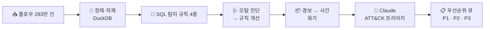

# 🛡️ SOC-Alert-Triage

**보안 경보가 너무 많아 진짜 공격을 놓치는 문제를, SQL 탐지 규칙과 Claude(LLM) 트리아지로 줄여본 프로젝트**

---

## 📌 한눈에 보기

| 지표 | 결과 |
|---|---|
| 🎯 공격 포착률 | **98.6%** (공격 플로우 기준, 라벨 보정 후 · 원래 라벨 기준 98.7%) |
| 🔕 헛경보율 | **6.8% → 3.9%** (규칙 개선) **→ 0.3%** (라벨 오류 보정) |
| 🔍 라벨이 놓친 공격 발견 | 감염 PC의 내부 정찰 **64,741건** |
| 📦 경보 압축 | 경보 477건 → 인시던트 105건 → **사건 74건** |
| 🤖 LLM ATT&CK 매핑 정확도 | **74% → 97%** (v1 → v2) |
| 📋 우선순위 분류 | 헛경보 8건 중 5건을 후순위로, 그 대가는 공격 플로우의 **0.9%** |

> **데이터**: [CIC-IDS2017](https://www.unb.ca/cic/datasets/ids-2017.html) 네트워크 플로우 2,830,743건 (5일간 가상 기업망 + 공격 14종)

---

## 🤔 왜 만들었나

보안관제센터(SOC)의 진짜 병목은 **공격을 못 찾는 것보다, 경보가 너무 많아 분석가가 진짜를 놓치는 것**이다. 이를 **경보 피로(Alert Fatigue)** 라고 한다.

그래서 두 가지 질문에 답하려 했다.

1. **적은 헛경보로 많은 공격을 잡을 수 있는가?**
2. **경보를 분석가가 바로 쓸 수 있는 형태로 정리할 수 있는가?**

---

## ⚙️ 파이프라인

### 지킨 원칙 4가지

| 원칙 | 이유 |
|---|---|
| **정답 라벨은 채점에만 쓴다** | 규칙과 LLM이 답을 보고 맞히는 것을 막기 위해 |
| **평소 모습은 월요일로 배운다** | 월요일은 공격이 없는 날. 평가는 화~금에만 한다 |
| **LLM 답을 그대로 믿지 않는다** | MITRE 공식 데이터로 기법 ID 실존 여부를 확인하고, 단순 규칙과 비교한다 |
| **기준값을 정답에 맞춰 바꾸지 않는다** | 오탐의 원인을 먼저 찾고, 그 원인에 맞는 조건만 추가한다 |

---

## 💡 핵심 발견 3가지

### 1️⃣ 헛경보의 원인을 찾아 고치니, 공격은 그대로 잡으면서 헛경보가 줄었다

1분 단위로 "누가 누구에게 어떤 행동을 얼마나 했나"를 보는 SQL 규칙 4개를 만들었다.

| 규칙 | 잡으려는 행동 | ATT&CK |
|---|---|---|
| R1 포트스캔 | 1분에 서로 다른 포트 50개 이상을 두드림 | T1046 |
| R2 무차별 대입 | 1분에 로그인 포트(21·22·23·3389)로 10번 이상 접속 | T1110 |
| R3 트래픽 폭주 | 1분 접속 수가 **그 서버 평소의 5배** 이상 | T1498·T1499 |
| R4 슬로우 DoS | 연결을 5초 넘게 붙잡고, 보낸 데이터는 1KB 이하 | T1499 |

1차 결과의 헛경보를 뜯어보니, 원인이 분명했다.

| 원인 | 고친 방법 |
|---|---|
| 서버의 **응답**이 거꾸로 기록돼 "포트 수천 개를 두드린 것"처럼 보임 | 출발지 포트가 1024 미만(서버 포트)이면 제외 |
| R4 헛경보의 **79%가 DNS(UDP)** 한 곳. UDP는 연결 개념이 없어 긴 연결처럼 기록됨 | TCP만, 목적지가 내부 서버인 것만 |

| | 1차 | 개선 후 | 개선 후 + 라벨 보정 |
|---|---|---|---|
| 포착률 | 98.7% | 98.7% | 98.6% |
| 정밀도 | 82.3% | 88.9% | **99.1%** |
| 헛경보율 | 6.8% | 3.9% | **0.3%** |

### 2️⃣ 남은 헛경보를 추적했더니, 원본 데이터의 라벨 오류였다

포트스캔 규칙(R1)의 헛경보 중 **63,251건이 PC 한 대(192.168.10.8)** 에서 나왔다. 규칙 개선 후 남은 헛경보 68,636건의 92%에 해당한다. 조사해 보니 세 가지 근거가 맞아떨어졌다.

| 근거 | 내용 |
|---|---|
| 🖥️ 같은 PC | "Infiltration(침투)" 공격 라벨이 붙은 PC와 동일 |
| ⏰ 같은 시간 | 감염 기간(14:19~15:45) 안에서 내부 PC 11대를 스캔 |
| 🔧 같은 도구 | 포트 약 1,000개, 범위 1~65389. 공격자의 포트스캔과 같은 nmap 흔적 |

실제 공격 흐름은 **PC 감염 → 감염된 PC로 내부망 정찰**이었다. 데이터 제작자는 첫 단계에만 공격 라벨을 붙였고, **정찰 단계는 "정상"으로 남겨뒀다.** 우리 규칙은 이 정찰의 97.8%를 이미 잡고 있었다.

> 라벨 보정은 탐지 규칙과 **다른 기준**으로 정의해 "내 규칙이 잡은 걸 정답이라 우기는" 순환 논리를 피했다. 원래 라벨 기준 성적도 함께 공개했다.

### 3️⃣ LLM 판정은 '자동 종결'이 아니라 '우선순위 분류'에 써야 한다

인시던트(v1)·사건(v2)마다 Claude에게 **"이게 공격인가? 공격이면 ATT&CK의 어떤 기법인가?"** 를 물었다.
IP는 `int-01`, `ext-03` 같은 가명으로 바꿔서 넘겼다. 유명한 데이터셋이라 실제 IP를 보면 문제를 푸는 대신 답을 기억해낼 수 있기 때문이다.

| | v1 | v2 |
|---|---|---|
| 분석 단위 | 인시던트 105건 | 사건 74건 (규칙 간 상관분석) |
| 추가 정보 | 없음 | 자산 정보 + 평소 기준선 |
| 존재하지 않는 기법 ID 생성 | 0건 | 0건 |
| ATT&CK 매핑 정확도 | 74% | **97%** |
| 놓친 공격 플로우 | 150,585건 | **0건** |
| 헛경보를 정상으로 걸러냄 | **75%** | 0% |

**v1과 v2는 정반대로 기울었다.**
- **v1**은 헛경보를 잘 걸렀지만 공격을 놓쳤다. 스캔이 조각나 판단 근거가 없었고, 방화벽 뒤 공격자를 "내부 프록시"로 오해했다.
- **v2**는 공격을 하나도 놓치지 않았지만, 헛경보도 전부 의심했다. "평소에 본 적 없는 통신"이라는 정보가 외부 사이트 접속(정상)에도 똑같이 켜졌기 때문이다.

그래서 **확신도로 우선순위를 나눴다.** 공격은 대부분 높은 확신도(중앙값 0.90)의 "악성", 헛경보는 낮은 확신도(0.30~0.50)의 "의심"을 받았다.

| 등급 | 조건 | 사건 | 공격 | 헛경보 | 공격 플로우 비중 |
|---|---|---|---|---|---|
| 🔴 P1 즉시 대응 | 악성 + 확신도 0.7 이상 | 53 | 51 | 2 | 37.1% |
| 🟡 P2 일반 검토 | 그 외 | 13 | 12 | 1 | 62.0% |
| 🟢 P3 후순위 | 정상, 또는 의심 + 확신도 0.5 미만 | 8 | 3 | **5** | **0.9%** |

> 공격 플로우 비중 = 등급별 공격 플로우 ÷ 전체 사건의 공격 플로우(613,790건)
>
> **헛경보 8건 중 5건을 후순위로 미루고, 대가는 공격 플로우의 0.9%.** 버리는 게 아니라 나중에 볼 뿐이다.
> 반대로 "정상이면 자동 종결"은 쓸 수 없었다. 공격을 놓치지 않는 기준에서는 105건 중 3건밖에 줄지 않았다.

---

## ⚠️ 한계

<b>펼쳐보기</b>

**데이터**
- 웹 공격, Bot, Heartbleed, SQL Injection은 연결 통계만으로 구분하기 어렵다. HTTP·WAF 로그 같은 내용 기반 탐지가 필요하다.
- 공격자가 방화벽 NAT 뒤에 있어, 실제 공격자가 아니라 방화벽 주소 단위로 묶인다.
- 데이터셋 자체의 품질 문제를 여럿 확인했다. 내부 정찰 라벨 누락, slowloris 라벨이 공격 시간 밖까지 흩어짐, TCP 연결인데 SYN 플래그 비율이 0으로 기록되는 등의 플래그 값 이상.
- **기준선이 실제보다 깨끗하다.** 월요일에는 내부 웹서버 접속이 아예 없어서 "평소 0건 → 지금 분당 1만 7천 건"이라는 쉬운 신호가 생긴다.

**방법론**
- v2는 세 가지를 한꺼번에 바꿔서, 각각이 얼마나 기여했는지는 분리하지 못했다.
- ATT&CK 매핑 정확도 향상의 상당 부분은 LLM이 아니라 상관분석 덕분이다. 규칙명 고정 매핑도 68% → 86%로 올랐다. 그래도 LLM이 11%p 높았고, Slowhttptest에서는 LLM 100% 대 규칙 0%였다.
- 우선순위 기준값(0.7, 0.5)은 이 74건을 보고 정했으므로 다른 데이터로 검증해야 한다.
- 평가 기간 플로우의 약 24%가 공격이라 현실보다 공격 비율이 훨씬 높다. 그래서 경보율보다 헛경보율을 주 지표로 봤다.
- LLM 판정은 실행할 때마다 조금씩 다를 수 있다. 수치는 `claude-sonnet-5-5` 실행 결과다.

## 🚀 다음 단계

<b>펼쳐보기</b>

- 변화를 하나씩 적용해 각각의 기여도 분리 (ablation)
- 다른 데이터셋(CSE-CIC-IDS2018, UNSW-NB15)에서 기준값 검증
- 평소 기준선 정보를 **내부 서버 대상 사건에만** 적용해 외부 접속의 오해 제거
- 같은 시간대의 같은 공격 사건을 더 크게 묶는 캠페인 단위 분석
- 탐지 규칙을 보안 업계 표준 형식(Sigma)으로 변환

---

## ▶️ 실행 방법

1. 노트북(`.ipynb`)을 Google Colab에서 연다.
2. Colab 왼쪽 🔑(보안 비밀)에 `ANTHROPIC_API_KEY`를 등록하고 **노트북 액세스**를 켠다.
3. 위에서부터 순서대로 실행한다.
   - 데이터(약 280MB)는 Hugging Face 미러에서 자동으로 받는다.
   - Claude 응답은 `llm_cache.json`에 저장되어, 다시 실행해도 이미 받은 답은 다시 묻지 않는다.

## 📚 출처

- Sharafaldin, Lashkari, Ghorbani, *"Toward Generating a New Intrusion Detection Dataset and Intrusion Traffic Characterization"*, ICISSP 2018 · [CIC-IDS2017](https://www.unb.ca/cic/datasets/ids-2017.html)
- 데이터 미러: [bencorn/CICIDS2017 (Hugging Face)](https://huggingface.co/datasets/bencorn/CICIDS2017)
- [MITRE ATT&CK CTI](https://github.com/mitre/cti)
